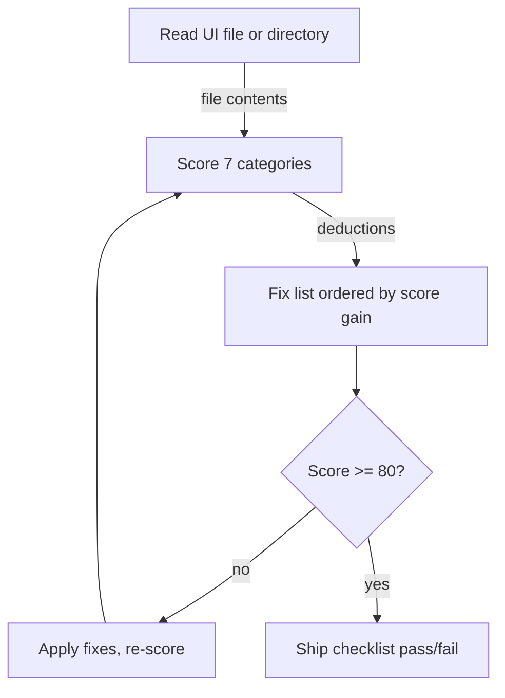

# README Generator

Reads the project, writes the README in one pass.

## Commands

```
/readme-generator                         # generate for current directory
/readme-generator <github-url>            # research the repo on the web first, then generate
/readme-generator --update                # update an existing README.md
```

---

## Instructions

### Step 0 — Research (if GitHub URL provided)

If the user provides a GitHub URL, run Step 1 first, then research the repo on the web. Use the Exa MCP if it is configured. If not, use WebSearch and WebFetch. If no search tool is available, skip this step.

Fill the bracketed values from the URL and the files read in Step 1. Run in parallel:

```
fetch: [repo-url] — repo description, topics, star count, recent activity
search: "[owner]/[repo]" — what people use it for and what problems it solves
search: "[main dependency] install command" — current install command
```

Use a research fact only if the local files confirm it. Drop anything the files contradict, and drop results about a different project with the same name.

If no GitHub URL provided: skip this step.

---

### Step 1 — Read the project

Run in parallel:

```bash
ls -la
cat package.json 2>/dev/null || cat pyproject.toml 2>/dev/null || cat Cargo.toml 2>/dev/null || cat go.mod 2>/dev/null || echo "no standard config"
```

Then:
- Glob for `SKILL.md`, `CLAUDE.md` — read fully if present, they define the interface
- Glob for `*.mjs`, `*.py`, `*.ts`, `*.sh` in `scripts/` or `bin/` — read entry points
- Read existing `README.md` if present — keep intentional parts (badges, specific examples), note what is missing or stale
- Grep for slash commands, exported functions, or CLI command names

Then read the files for the detected type:

| Type | Read |
|---|---|
| **Claude Code skill** | `SKILL.md` commands, tools, description; MCP tools in the frontmatter; any example invocations |
| **npm package** | `package.json` name, description, main, exports, scripts, peerDependencies; the entry point's exports; `tsconfig.json` |
| **Python package** | `pyproject.toml` or `setup.py` name, dependencies, entry points; `requirements.txt` |
| **Script collection** | Each script in `scripts/` — arguments and output; any file that explains run order |

Ask: **who installs this and what do they do first?** That is the job of the README.

---

### Step 2 — Classify the project

| Type | Signals | README sections, in order |
|---|---|---|
| **Claude Code skill** | `SKILL.md` present | Title → one-liner → Install → Usage → What it does → What it doesn't do → Requirements → License |
| **CLI tool** | `bin/` entry, shebang line | Title → one-liner → Install → Usage (flags + real output) → Configuration → License |
| **npm package** | `package.json` with `main`/`exports` | Title → one-liner → Install → Usage (import + real call) → API → Configuration → License |
| **Python package** | `pyproject.toml` or `setup.py` | Title → one-liner → Install (pip + venv) → Usage → Configuration → License |
| **Script collection** | Multiple scripts, no package config | Title → one-liner → Scripts table (name, what it does, command) → Requirements → License |
| **Non-standard repo** | None of the above | Title → one-liner → Project structure → What to run first → License |

---

### Step 3 — Generate the README

Use only the sections that apply. Skip a section rather than leave it empty or write a TODO.

#### Title and description

Project name as `# H1`. One sentence below it — what it does and for whom. Not "a tool that helps you" — just the thing itself.

**Good:** `Generates pre-call intelligence briefs on founder-operated businesses using web research and Companies House data.`
**Bad:** `A powerful, robust tool that helps developers streamline their documentation workflow.`

#### Diagram (Mermaid, when the project has a real flow)

Add one Mermaid diagram when the project has more than one moving part in sequence — a pipeline, a multi-step skill, a request/response flow, several scripts that run in order. Skip it for a single-function utility or a flat config file.

- Use a fenced ```mermaid block placed directly under "What it does"
- Use `flowchart TD` or `flowchart LR` — the most reliably rendered type on GitHub
- Label edges with what passes between steps, not just arrows
- Draw only the real steps in the code — never invent a step to fill the diagram



#### Install

Exact commands only, 4 lines or fewer. If setup needs more, add a Configuration section after Usage.

```bash
# Claude Code skill: clone
git clone https://github.com/user/repo ~/.claude/skills/skill-name
# npm
npm install package-name
# Python
pip install package-name
```

#### Usage

Show the real command with realistic arguments, not a toy example. For skills, show the slash command. For CLI tools, show flags and real output where possible. For packages, show the import and one real call.

```
/founder-research "Acme Ltd" acme.co.uk
/founder-research "Acme Ltd" acme.co.uk --sherlock
```

#### What it does

Include for non-obvious projects. Bullet list, active verbs, specific. Skip if Usage already makes it clear.

**Good:**
- Runs three parallel web research queries (company, founder, market)
- Pulls Companies House filing data for UK businesses

**Bad:**
- Helps you research businesses
- Provides useful insights

#### What it doesn't do

Include whenever there are likely misconceptions.

- Does not contact the business or send anything externally
- Requires a web search MCP configured in Claude Code — will not run without it

#### Requirements

List only what is not automatic: MCP servers, API keys, external tools. Skip universal runtimes such as Node 18+ or Python 3.

```bash
EXA_API_KEY=...   # add to Claude Code MCP config
```

#### Configuration

If the project has meaningful config (env vars, settings files, flags), name each variable, show the format, and say when to change it.

#### Project structure

Include for non-standard repos. Annotated tree, short.

```
scripts/        # zero-dependency .mjs scripts — run directly with node
schemas/        # JSON schemas for intake and audit data
```

#### License

One line. `MIT` or `Apache-2.0` — no preamble.

---

### Step 4 — Voice rules

Apply throughout. No exceptions.

- No word that can be cut
- No passive where active works
- No filler adjectives: "powerful", "robust", "seamless", "comprehensive", "simple", "easy"
- No marketing tone — write for the person installing it, not a product page
- No emojis unless the user asks
- Present tense. Declarative sentences for descriptions, imperative sentences for instructions
- All commands in code blocks — never inline

#### STE pass

When the draft is complete, run one pass of ASD-STE100 Simplified Technical English (STE) over all prose, the About line included. Code blocks, commands, identifiers, file paths and quoted output stay as they are.

Keep every recommendation. State it as a fact or start it with "We recommend". This rule applies in both cases below and overrides any rule in `simple-english` that deletes suggestions.

If the `simple-english` skill is installed, run it in its default mode, not strict. If not, apply these rules:

- Procedures (Install, Usage, Configuration steps): imperative, one instruction per sentence, 20 words or fewer
- Descriptions: one new fact per sentence, 25 words or fewer
- A condition comes before its command: "If the build fails, read the log."
- Active voice and simple tenses only. No "-ing" form as a verb
- One name for one thing in the whole README — not "config" in one section and "settings" in another
- Modals: "can", "will", "must" only. A requirement takes "must"
- No semicolons, contractions or Latin abbreviations. Write "for example", not "e.g.". Name the items instead of "etc."
- Short is not telegraphic: keep articles and "that"

Domain words stay. "Webhook", "commit" and "deploy" are legal technical words.

---

### Step 5 — GitHub About (whenever a GitHub remote exists)

If `git remote -v` shows a `github.com` origin, also write a one-line **About** for the repo's GitHub description field. It is separate from the README.

- One sentence, 160 characters or fewer, no trailing period
- Same substance as the README one-liner, tightened further
- Follow Step 4
- 3–6 lowercase topics as a separate list

```
About: Scored 0-100 design review gate for UI code, ordered fix list by score gain
Topics: claude-code, design-review, ui-audit, design-system, skill
```

---

### Step 6 — Output

1. Show the generated README in the conversation, with the About line and topics if a GitHub remote exists
2. Ask: "Write to README.md?" Write only on approval. If a README.md exists, say so in the question
3. If a GitHub remote exists and `gh` is authenticated, ask separately: "Set this as the repo's About?" On approval, run `gh repo edit <owner>/<repo> --description "..." --add-topic topic1,topic2`
4. Offer one round of specific edits

---

## Error handling

**No config files found:** Glob for `.md`, `.mjs`, `.py`, `.sh` and read the most plausible entry point. Don't give up.

**SKILL.md present but sparse:** Generate from what's there. Flag gaps to the user, don't invent content.

**Multiple languages detected:** Cover each in Usage and note the polyglot nature in the description.

**Can't determine project type:** Ask one question — "What does someone do first after cloning this?" — then proceed.
